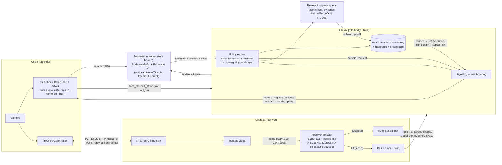

# Ruletka: AI content moderation plan and competitor UI review

*Research only. Nothing was built, deployed, bought or sent. Prepared 2026-10-08 (MT).*
*Code reviewed: `scriptier/ruletka` @ `main` commit `396d32f` (2026-08-26), cloned read-only to `/workspace/ruletka-moderation/repo`.*
*Labels used below:* **[confirmed]** = seen in a primary source or in code; **[inferred]** = my reading of evidence; **[unverified]** = a claim I could not check, such as a vendor's own marketing.

---

## 0. TL;DR

- **Ruletka already has most of the building blocks.** The web client runs **nsfwjs** in the receiver's browser. On a hit it blurs the partner, blocks them, skips, and sends a `report_user` with reason `explicit_ai` to the hub. The hub auto-bans by user_id and IP once 3 independent reporters agree (90 days). What's missing: (1) the mobile app has **no** on-device model, (2) there is **no face-presence signal**, (3) there is **no server-side confirmation**, so AI flags count only as one more report, and (4) the model is a general web-image classifier loaded from a public CDN.
- **Recommendation:** use a hybrid design:
  1. Run detection on the **receiver's device**, the person who would see the nudity. This works even if the offender modified their own client.
  2. Add an optional **sender self-check** so honest users are blocked from the queue or blurred before anyone sees them.
  3. When a flag fires, upload **one small evidence frame**, which a **self-hosted** confirmer on the hub re-scores (NudeNet / Falconsai).
  4. **Ban automatically** only when the server confirms the frame, or when several independent partners flag the same user.
  5. Keep paid APIs only as an optional tie-breaker inside free tiers.
  6. Keep the UI unchanged. Face presence is a silent signal and a text hint, with no circles.
- **Build estimate:** about **34–56 dev-days** across 6 phases (§1e).
- **UI:** Ruletka looks premium, but it takes 3 taps plus a camera prompt before searching starts. The landing page's main button is **"Invite friends"**, not Start. An "Update available" banner appears on a first visit. The interface also leans on jargon (stars, wallet, hubs, helpers). See the top recommendations in §2.

---

## PART 1: AI content moderation

### 1.0 What Ruletka already has (from the code) [confirmed]

| Area | What exists | Where |
|---|---|---|
| On-device NSFW (web) | nsfwjs 2.4.2 + tfjs 4.22.0 loaded **at runtime from cdn.jsdelivr.net**. Scans the **remote** video every **2.2 s** at 224×224. Hit if `porn≥0.72 \|\| hentai≥0.78 \|\| (porn≥0.55 && sexy≥0.5)`. On a hit it blurs the partner, sends `report_user{reason:"explicit_ai"}` and `block_user`, then skips. **Default ON.** Disabled on "FX-lite" (weak GPU or Safari) and for friend calls. | `ui/live.js` ~L27584–27731, `ui/live.html` toggle `chk-nsfw-auto` |
| On-device NSFW (mobile) | **None found.** No tflite, onnx or nsfw dependency in `mobile/package.json` or `mobile/src`. Mobile has the blur veil (`PartnerBlurVeil.tsx`) and a report sheet with a one-tap "Explicit" button. | `mobile/src/safety/ReportSheet.tsx` |
| Report evidence | The mobile report sends a stage screenshot (`react-native-view-shot`, base64 JPEG capped at 120 KB). The hub saves it beside `reports.jsonl`. | `mobile/app/live.tsx`, `mobile/src/hub/HubClient.ts`, `bridge/src/simple.rs::handle_report_user` / `save_report_screenshot` |
| Auto-ban policy | Severity table: `underage` 1 reporter → 30 days. `explicit`/`explicit_ai` **3 unique reporters → 90 days**. Harassment/hate 3 → 14 days. Spam 4 → 7 days. Reporters are rate-limited to 8 per hour. Raid detection: 6 reports in 15 min caps the ban at 48 h. Bans are applied to **user_id and IP** (`match_bans`, `match_ip_bans`). Trust and stars clawback on ban. There is a "priority mod" reporter whose single report means a permanent user + IP ban. There is an optional moderation webhook. | `bridge/src/simple.rs` ~L3216–3270, ~L7390+ |
| Docs drift | `docs/OPS.md` still says explicit = weight 2 / 7 days and explicit_ai = "threshold+1 / 7 days". The code says 3 reporters / 90 days. `safety.html` says "3+1". These should be reconciled. | `docs/OPS.md` L110–118 |
| Identity | Device key in IndexedDB. A derived `user_id` is sent to the hub. A new browser profile means a new identity (only IP bans persist). | `ui/identity.js` |
| TURN | Configurable `ice_servers` from the hub's `/config.json`. There are force-relay and turn-only modes. **Media through TURN is still DTLS-SRTP encrypted, so a TURN relay cannot see frames.** Server-side moderation therefore needs the clients to send samples. | `ui/webrtc.js` |
| Admin | `/admin.html` (token-protected): reports, bans, unban, recent matches. | `bridge/src/main.rs` routes |

### 1(a). How competitors moderate

#### "ruleta.com-app": not identified

I could not find a product at that name. `ruleta.com-app.com`, `.ru` and `.net` did not resolve or returned errors from my box and from the fetch service. `ruleta.com` did not respond. `ruleta.app` is a parked domain for sale. App store searches for "Ruleta" video chat only found unrelated apps (decision wheels, "Rulet TV", "ChatLife") and the "Chatruletka/Ome.tv" network apps. **Nothing in this report about "ruleta.com-app" is confirmed.** I need Anton to send the exact URL or store link (open question Q1).

What I could verify is the closest analogue: **Chatroulette.com**. Its own public site states that it uses face detection and automated sampling.

#### Chatroulette (chatroulette.com)

- **[confirmed, public site]** The homepage says: "Video samples are analyzed by automated moderation systems… Potential violations may lead to an automatic ban or further review by our moderation team… 18+… zero tolerance." The `/safety` page lists "PhotoDNA/CAID hash-matching, AI image-/video-/text-classifiers operate in real time", "Human Moderation: 24/7", "Risk-based age-estimation", "device and payment-token blocks", and "Appeals: None for CSAE violations". Sources: https://chatroulette.com/ and https://chatroulette.com/safety
- **[confirmed, onboarding UI]** One screen with an "I am 18 or older" checkbox and "Agree & continue", then a preferences sheet with a **"Partner's video: Face focus | Full video"** toggle, then Start (screenshots `flow_chatroulette_mob_2.png`, `flow_chatroulette_mob_3.png`). I did **not** press Start, to avoid connecting to real users.
- **[confirmed, from Chatroulette's public JS bundle; behaviour inferred]** The shipped bundle includes `@mediapipe/face_detection`, `@tensorflow-models/face-detection`, `@tensorflow/tfjs` with WASM and WebGPU backends, and `@tensorflow/tfjs-react-native`. It has a Redux `faceDetection` slice (`faceDetected`, `lastDetectedTime`, `backendSampleRequestTime`). A server message `sampleRequestedMessage` → "Backend sample requested". A `/sampler` endpoint takes samples with metadata (`faceStatus`, `blurriness`, `mean`, `std`). A device **benchmark** decides `shouldUseNSFWModel` (the on-device NSFW model runs only on capable devices). There are metrics `nsfw_classification_time` and `face_detector_failure`. Moderation classes are `Allowed, Risky, Shirtless, NSFW, Spam, Fake, Underage`, and ban-reason strings include "Shirtless appearance" and "Suspected use of a fake video".
  - **Inferred architecture:** on-device face detection on the sender runs continuously. A face-missing state triggers a client callback, probably blur or pause. The on-device NSFW model runs only on strong devices. The server can **request a frame sample on demand** and samples are classified server-side. Bans are issued automatically or after human review.
  - **This is the closest public evidence for a "face-following circle" system: face detection plus server sampling plus auto-ban. Ruletka can copy the detection logic without the circle UI.**
- History [confirmed, press]:
  - 2011: a face and skin detector; about 100 human moderators (Vice: https://www.vice.com/en/article/chatroulette-moderation-penis-problems/).
  - **June 2020: hired Hive** for nudity detection (same source).
  - myYearbook (2011) found that "images with faces are 5 times less likely to contain nudity", but about 20% of nudity streams also contain a face. They used two-tier human review at about 400 images/min per reviewer (TechCrunch: https://techcrunch.com/2011/04/23/geoff-cook-how-solved-chatroulette-porn-problem/).
  - **The lesson: a face is a strong negative signal for nudity, but not proof of safety.**

#### Ome.tv / Chatruletka / Videochat RU (one shared network)

- **[confirmed]** The rules (https://ome.tv/rules/) ban nudity, underwear, a naked torso with a hidden face, pointing the camera below the chest, touching intimate parts, screens/photos/text in front of the camera, and virtual cameras or filters. They require that "**your real, uncovered face must always be visible in the frame**".
- Reports include **a screenshot of the partner's video** and go to 24/7 moderators. "**Our system automatically bans users who receive multiple complaints in a short duration**." The web UI shows "Please keep your face visible in the camera frame" next to Start (screenshot `ometv_desk.png`).
- **[confirmed, third party]** The open-source *videochatru-extension* README says these sites (ome.tv, videochatru.com, chatruletka, minichat and 40+ mirrors) share one user base, connect "directly through webrtc", and the service "earns money with paid unbans" (https://github.com/ottenok21/videochatru-extension). Paid unbans of about $10–15 are reported only by third-party blogs **[unverified]**.
- I found no public technical description of their automatic AI.

#### Azar (Hyperconnect / Match Group)

- **[confirmed, press 2021]** Azar uses an "ultra-lightweight on-device AI engine" (since Feb 2017). Its "AI monitoring system" can "pre-block unwanted video content within 0.006 second, depending on device", and video is "not sent to the server". AI also pre-screens user reports and escalates them to staff (BusinessKorea: https://www.businesskorea.co.kr/news/articleView.html?idxno=59272). The 0.006 s figure is the vendor's claim and was not checked independently.
- azarlive.com blocked the headless desktop browser (Cloudflare). Mobile web loaded (`azar_mob.png`: "147,627 are matching now!", cookie wall, login).

#### Monkey

- Public pages: "Experience a moderated environment powered by smart AI tools". The site requires sign-in (Google, Apple, TikTok, Facebook, email) and two consent checkboxes (`monkey_mob.png`). I found **no technical documentation** of Monkey's detection, so any vendor or model is unknown.

#### TalkRand (a useful reference for "detection only")

- **[confirmed it is claimed; accuracy unverified]** https://talkrand.com/ru/ai-protection says it uses an NSFW.js-based model, fine-tuned and quantized (INT8/FP16), running in the browser via TF.js WebGL/WASM. It scans **before matching**: no entry to the queue if inappropriate, and the model must be ready before chat starts. It also scans **during** the chat: the connection drops on a violation and repeat offenders are banned. Frames never leave the device. The claimed "99.2% accuracy, <50 ms" is a vendor claim and **unverified**.

### 1(b). Detection options

#### Open-source models

| Model | What it outputs | Size | Accuracy (as published) | License | Runtimes | Fit for Ruletka |
|---|---|---|---|---|---|---|
| **nsfwjs** (infinitered) | 5 classes per image: Drawing, Hentai, Neutral, Porn, Sexy | MobileNetV2 2.6 MB hosted (3.5 MB bundled); MobileNetV2Mid; InceptionV3 (299 px) | "~90% small, ~93% midsized" (README) | **MIT** | TF.js (browser/Node); the Keras/TF originals can be converted to TFLite | Already in use. Good first gate. It is a whole-image classifier trained on web imagery, so it is weaker on dim webcam frames, partial framing and shirtless-vs-nude cases **[inferred]** |
| **GantMan/nsfw_model** (source of nsfwjs) | same 5 classes | MobileNetV2 224 (Keras/TFJS/quantized TF links) | 93% (InceptionV3 confusion matrix) | GitHub reports "NOASSERTION" (check the LICENSE file) | Keras, TF, TFJS | Use for a **TFLite build for mobile** |
| **NudeNet v3** (notai-tech) | **Detector with boxes**: 18 labels incl. `MALE_GENITALIA_EXPOSED`, `FEMALE_GENITALIA_EXPOSED`, `FEMALE_BREAST_EXPOSED`, `BUTTOCKS_EXPOSED`, `ANUS_EXPOSED`, `FACE_MALE`/`FACE_FEMALE` | 320n.onnx **12.2 MB**; 640m.onnx **103.5 MB** | No published accuracy table | **AGPL-3.0** (based on Ultralytics YOLOv8) | ONNX (Python, ORT Web; the author's demo runs in the browser) | **The best open signal for "man exposing himself / masturbating"**, because the labels are anatomy-specific. **Measured on my box: ~31 ms/frame** for 320n on an 8-vCPU Xeon with onnxruntime on CPU. Because of AGPL, run it as a **separate service** (Ruletka itself is LGPL-2.1) and publish any changes to it |
| **Falconsai/nsfw_image_detection** | normal / nsfw (ViT-base fine-tune on 80k images) | model.safetensors **343 MB** | eval_accuracy **0.980** on its own split | **Apache-2.0** | PyTorch/Transformers (ONNX export possible) | **Server-side confirmer** for evidence frames. Too big for clients |
| **OpenNSFW2** (bhky) | single NSFW probability (Keras port of Yahoo open_nsfw) | ~ResNet-50 size (not measured) | not stated | **MIT** | TF/Keras | Alternative server confirmer |
| **Yahoo open_nsfw** | single probability | Caffe | n/a | BSD-2; **archived 2018** | Caffe | Legacy. Prefer OpenNSFW2 |
| **MediaPipe Face Detector (BlazeFace short-range)** | face boxes + 6 keypoints | **230 KB** float16 `.tflite` (measured with HEAD) | n/a | **Apache-2.0** (mediapipe repo) | MediaPipe Tasks Web (WASM/WebGL), Android, iOS; TF.js `face-detection` | **Face-presence signal** with no UI. Chatroulette ships exactly this (see 1a). I could not benchmark it on the box because libEGL was missing; take latency from Google's docs or measure on devices |
| CLIP-based zero-shot (e.g. OpenCLIP + text prompts) | similarity to "nude person", "person in underwear", "penis" etc. | ~150 MB+ (ViT-B/32) | depends on prompts; no standard benchmark | MIT (OpenCLIP) | server | Optional server second opinion and edge-case triage. Not recommended as the primary detector |

Licence and stars were taken from the GitHub API on 2026-10-08: nudenet AGPL-3.0, ★2.5k; nsfwjs MIT, ★9.0k; opennsfw2 MIT; yahoo/open_nsfw BSD-2, archived; mediapipe Apache-2.0.

#### Where the models run

- **Web, on the client:** TF.js (WebGL/WebGPU/WASM) for nsfwjs and BlazeFace. **ONNX Runtime Web** (WebGPU/WASM) for NudeNet 320n (12 MB, so load it lazily and cache it in the Cache API). **Self-host the model files.** Today Ruletka loads them from jsDelivr, which is a supply-chain and availability risk, notably for RU users **[inferred]**.
- **React Native / Expo, on the client:** run a TFLite model with `react-native-fast-tflite` (GPU delegate), or use `onnxruntime-react-native`. Both need a dev client or prebuild. **The hard part is getting frames.** `react-native-webrtc` renders through a native view. Options:
  1. Periodic `captureRef` of the RTCView. The app already does this for report screenshots, but it costs CPU and may return black frames on some Android SurfaceViews **[inferred]**.
  2. A small native module that attaches a `VideoSink` to the remote (and local) `VideoTrack` and hands a downscaled 224/320 px frame to the model every 1–2 s. This is better but needs Kotlin/Swift work.
- **Server side:** the media is P2P plus SRTP, so the hub/TURN never sees frames. Server checks only see **frames that clients upload** (evidence on a flag, or sampled on request, as Chatroulette does).

#### Paid APIs (public list prices, checked 2026-10-08)

| API | Free tier | Price | Notes / link |
|---|---|---|---|
| **Sightengine** | **2,000 ops/month (max 500/day)**, no time limit | Starter **$29/mo** for 10k ops + $0.002/op. Pro **$99/mo** for 40k ops + $0.002/op (live-stream moderation only on Pro and above) | Nudity check on an image = 1 op. https://sightengine.com/pricing |
| **Hive** Visual Moderation | "$50+ in free credits after adding a payment method" | **$3.00 / 1,000 requests** (self-serve limit **100 requests/day**). Higher limits and video via sales | https://thehive.ai/pricing (price taken from the page HTML). Chatroulette used Hive from 2020 |
| **AWS Rekognition** `DetectModerationLabels` | 12-month free tier: **1,000 images/month**. New accounts after 2025-07-15 get **up to $200 in credits** instead | **$0.001/image** for the first 1M, then $0.0008 (Group 2). Stored-video moderation $0.10/min | https://aws.amazon.com/rekognition/pricing/ |
| **Google Cloud Vision** SafeSearch | **First 1,000 units/month free** | **$1.50 / 1,000** (1,001–5M); $0.60 / 1,000 above 5M. Free when combined with Label Detection | https://cloud.google.com/vision/pricing |
| **Azure AI Content Safety** (image) | **F0: 5,000 images/month** (hard stop) | **$0.75 / 1,000 images** (S tier, from Azure's pricing-calculator API; the public page showed "$-" placeholders) | https://azure.microsoft.com/en-us/pricing/details/content-safety/ |
| Yandex Cloud | — | I found **no current public adult-moderation SKU**. The old "Image Moderation" API dates from 2016 | Unverified; worth checking for RU data residency |

**Scale reality check** (my arithmetic). Continuous API scanning at 1,000 concurrent users and 2 frames/min each is about 86M frames/month: roughly **$65–$170k/month** at the prices above. **APIs only make sense as a tie-breaker on already-flagged frames.** For example, 5,000 escalations/month fits Azure F0 for free, or costs about $6 on Google. A self-hosted NudeNet 320n handled about 32 frames/s on one 8-vCPU box in my test.

### 1(c). Recommended approach for Ruletka's P2P stack

**Core principle:** the person who would *see* the nudity (the **receiver**) runs detection on what they receive. A malicious sender cannot switch off a check that runs on the victim's device, so receiver-side detection is the backbone. Sender-side checks are a courtesy for honest users. Server confirmation is what makes automatic bans fair.

1. **Receiver-side detection (web and mobile)**, on every stranger match, default ON:
   - Every **1–2 s**, take a 224/320 px frame of the remote video and run:
     - **BlazeFace** for face presence.
     - **nsfwjs Mid** for a general NSFW score.
     - On capable devices only (decided by a benchmark, as Chatroulette does), **NudeNet 320n** for genital/breast/buttocks boxes.
   - **Temporal rule:** act on **k-of-n** frames (e.g. 2 of the last 3) instead of a single frame. This cuts flicker false positives.
   - **Graduated action:**
     - *Suspicion* (e.g. no face for >5 s, or "sexy" high): **auto-blur the partner** using the existing blur. The partner sees nothing; the receiver can tap to unblur.
     - *Hit* (NudeNet exposed-genitalia ≥ threshold, or nsfwjs porn high on k-of-n): blur, **block, skip**, and send `explicit_ai` with the scores and **one evidence frame** (JPEG ~320 px, ≤50 KB).
2. **Sender-side self-check** (honest clients):
   - **Pre-queue gate:** the camera must show a face and no NSFW before `queue` is sent (TalkRand-style).
   - **During the call:** if the local frame scores NSFW, blur or pause the outgoing video locally and log a self-strike.
   - **Face-required rule without circles:** if no face is seen for N seconds, show a small text toast ("Keep your face in frame") and **blur outgoing video until a face returns**. The hub receives `face_ok:false` as a low-weight signal.
3. **The hub turns client verdicts into evidence, not truth.** The hub cannot trust any client (the code is open source and forks and federation exist), so:
   - Each `explicit_ai` flag carries the model version, scores, timestamp and evidence frame. The hub sends the frame to a **self-hosted confirmer** (NudeNet 640m plus Falconsai ViT; optionally Azure or Google inside their free tiers).
   - **Confirmed** (the server model agrees above a high threshold): **immediate automatic ban** of user_id plus device binding plus IP (strike ladder, e.g. 24 h → 7 d → 90 d → permanent). The ban goes to a human-review queue for appeals.
   - **Not confirmed:** count it only toward the existing 3-reporter rule.
   - **Defence against framing:** a malicious reporter could upload someone else's nude image. Mitigations:
     - **Sample-on-demand**, the Chatroulette pattern. When a user is flagged, the hub sends `sample_request` to the **accused's** client to upload its own outgoing frame. A refusal or a modified client counts as a signal.
     - Require **≥2 independent partners** for a ban without server confirmation.
     - Weight flags by reporter trust (the effective-trust system already exists).
     - Rate-limit flags per reporter (already 8/h).
4. **Ban identity:** keep user_id + IP, and add:
   - On web, a privacy-disclosed **browser fingerprint hash** (e.g. the open-source FingerprintJS).
   - On Android, a **Keystore-backed install key**.
   - **Do not rely on Google Play Integrity.** RuStore rule 8.4.2 removes apps whose protections "prevent install/launch… when distributed via RuStore (e.g. Google Play Integrity)".
   - Use IP /24 bans with care: CGNAT and mobile carriers will cause collateral bans, so cap their duration.
   - New identities start on "probation": partners see them blurred first, with more frequent scans.
5. **Appeals:**
   - A ban screen with reason, duration and an appeal button that opens a hub queue showing the blurred evidence (the existing admin UI can be extended).
   - Auto-expire the evidence (e.g. 30 days, or at once when an appeal succeeds).
   - Add a published transparency line on `/safety.html`.
6. **Privacy:**
   - Normal frames never leave the device.
   - Only **flagged evidence frames** (and, if Anton opts in, rare sampled frames) are uploaded. They are processed in memory and deleted unless confirmed.
   - **The homepage claim "Video goes peer-to-peer, not uploaded to us" must be reworded** if any frames are uploaded (e.g. "video is P2P; a single still may be sent for safety checks when a violation is detected").
   - Note that the mobile report already uploads screenshots, so the current wording is already slightly inaccurate.
7. **False positives:**
   - Run in **shadow mode** (log only, no bans) for 1–2 weeks.
   - Calibrate thresholds on real webcam conditions: shirtless men, swimwear, dark rooms, skin-coloured walls, babies on screen, posters and TV.
   - Keep server confirmation in the loop.
   - "Shirtless" should be a separate, softer class (Chatroulette treats "Shirtless appearance" as its own ban reason). Anton should decide whether shirtless is a violation at all.
8. **18+ and illegal content:**
   - Underage presence is the worst case. Any evidence storage can become **storage of illegal material** if a minor appears. Keep storage minimal, encrypted, access-logged and short-lived, and **get legal advice on reporting duties**.
   - Chatroulette reports confirmed CSAM to INHOPE. US providers have NCMEC duties. Russian Criminal Code arts. 242.1–242.2 apply in RU.
   - Open-source age estimation is unreliable; use it as a flag only.
9. **Russia / RuStore** (not legal advice; for a lawyer to confirm):
   - **152-FZ:** faces in evidence frames are personal data, and arguably **biometric** if used to identify people. Primary collection for RU citizens must be **localized in Russia**. Sending frames to US APIs (AWS, Google, Azure, Hive, Sightengine) is a **cross-border transfer** with notice requirements. This is a strong reason to **self-host the confirmer**, ideally on an RU-located hub for RU users.
   - **149-FZ ОРИ registry and "Yarovaya" 374-FZ storage:** RuStore's guide flags these for communication apps (rule 3.6 / table 12.1). The applicability to a P2P video hub is an **open legal question**.
   - **RuStore UGC rules** (3.5 / 8.3) require Terms of Use, complaint mechanism, user blocking, moderator contacts and 152-FZ consent. **18+ apps may not contain pornography**, so moderation is mandatory in practice. Source: https://www.rustore.ru/help/developers/publishing-and-verifying-apps/requirement-apps
10. **Google Play / Apple:**
    - Google Play's UGC policy requires "robust, effective, and ongoing UGC moderation". **Incidental sexual content must be hidden by default behind filters that need ≥2 user actions to disable** (https://support.google.com/googleplay/android-developer/answer/9876937). Today the web toggle is one tap and mobile has no filter. **Mobile needs the on-device filter, default ON, before or with the Play launch.**
    - **Apple App Review 1.2** (updated 2026-06-08) explicitly says apps used for "**Chatroulette-style experiences, random or anonymous chat… do not belong on the App Store and may be removed without notice**" (https://developer.apple.com/app-store/review/guidelines/). **This is a major risk for the planned iOS app** whatever moderation is built. Strong moderation, accounts and timely report handling improve the odds but guarantee nothing.

### 1(d). Architecture

**Components:**
1. Shared detector module, with one model config for web and mobile.
2. Mobile native frame tap (Android first).
3. Hub protocol additions: `explicit_ai` evidence payload, `face_ok`, `sample_request`/`sample`, `ban_notice`.
4. A moderation worker (Python + onnxruntime, Docker, internal HTTP only), deployed next to the bridge.
5. Policy engine changes in `simple.rs`.
6. Admin review/appeal UI and evidence TTL job.
7. Metrics: hits, confirmations, false-positive rate on appeals, and model latency per device class.

### 1(e). What it takes to build

| Phase | Scope | Effort (dev-days) |
|---|---|---|
| 0. Hygiene | Self-host the model files (drop the jsDelivr runtime loads); reconcile OPS/safety/code thresholds; add metrics; build an internal eval set and harness (licensed datasets plus consenting staged clips) | 2–4 |
| 1. Web receiver v2 | BlazeFace face presence; nsfwjs Mid; k-of-n smoothing; graduated blur → skip; optional NudeNet-320n via ORT Web behind a device benchmark; evidence frame with flag | 5–8 |
| 2. Mobile on-device | Native frame tap on the react-native-webrtc remote/local tracks (Android Kotlin first, iOS later); TFLite (fast-tflite) or ONNX RN; same policy as web; filter default ON and two actions to disable (Play) | 8–12 |
| 3. Hub + moderation worker | Protocol messages; evidence intake (size caps, rate limits); self-hosted confirmer (NudeNet-640m/Falconsai); strike ladder; sample-on-demand; retention/TTL | 6–10 |
| 4. Identity, bans, appeals | Device key binding (Keystore / WebCrypto non-extractable key); optional fingerprint hash; ban screen; appeal flow; admin queue with blurred evidence | 5–8 |
| 5. Sender self-check | Pre-queue gate; face-in-frame toast; outgoing self-blur; self-strike signals | 3–5 |
| 6. Shadow mode, tuning, rollout | 1–2 weeks of log-only; threshold calibration; FP review; staged enforcement; docs/privacy/ToS updates (incl. RU text) | 5–9 |
| **Total** | | **≈34–56 dev-days** (about 7–11 weeks for one developer). Excludes ongoing human review time and legal work |

**Risks:**
- Model accuracy on real webcam footage (dim light, motion blur, partial framing).
- The mobile frame-extraction performance and battery cost.
- A false-ban backlash.
- AGPL obligations if NudeNet code is modified.
- Liability for storing evidence (minors).
- The 152-FZ localization and transfer question.
- iOS App Store policy 1.2.
- Forks and federated hubs that skip moderation (federation peers may need a "moderation-capable" flag).
- Evasion: virtual cameras, sex shown with the face also in frame, a phone pointed at a screen.

**Open questions for Anton:**
1. **The exact "ruleta.com-app" URL or store listing**, plus a screen recording of the circle and ban behaviour you saw.
2. Is "shirtless" a violation, or only exposed genitals/breasts and sexual acts?
3. Is uploading single frames to your own hub acceptable (evidence on a flag only? random sampling of new users?), and with which privacy wording?
4. Where is the hub for RU users hosted? Is RU localization of the evidence store required?
5. Ban ladder durations; whether permanent bans exist without human review; whether paid unbans are acceptable (I recommend no).
6. Who reviews appeals, and what is the target response time?
7. Should federation peers that don't run moderation still share the stranger pool?
8. Given Apple 1.2, how much does the iOS launch matter?

---

## PART 2: Competitor UI comparison

Screenshots are in `/workspace/ruletka-moderation/shots/`. Two viewports were used: desktop 1366×850 (`*_desk.png`) and iPhone 390×844 (`*_mob.png`). Onboarding walk-throughs are in `flow_*.png`. Raw page text is in `shots/pages.json`. Limitations:
- Chatrandom (desktop) and Azar (desktop) returned bot-protection pages.
- The Ruletka Play listing for package `me.ruletka.app` returned **404** (not public or not live).
- I did not press Start on competitor sites (no contact with real users).
- In headless Chromium, Ruletka's live page showed "No camera — You're on microphone" even with a fake camera. This may be an artifact of the test setup and should be checked on a real device.

### Side-by-side

| | Ruletka (ruletka.me) | Chatroulette | Ome.tv / Videochat RU | Chatrandom | Azar (web) | Monkey | TalkRand |
|---|---|---|---|---|---|---|---|
| **Taps to first search (web)** | Home → "Join now/Start chatting" → **18+ modal** → **User agreement modal** → **Start chatting** → camera prompt (3 taps + permission) | Checkbox + "Agree & continue" → prefs sheet → Start (2–3 taps) | Big **Start** on the chat page itself; agreement is implied ("By pressing Start you agree…") (1 tap) | Gender select + **Start Chat**; consent implied (1–2 taps) | Login wall | **Account required** (Google/Apple/TikTok/FB/email + 2 checkboxes) | "Start chatting" CTA plus a cookie banner |
| **Landing primary CTA** | Hero: **"Invite friends"**; "Join now →" is a small pill; "Start chatting" sits in the desktop header (not visible in the mobile header) | "Agree & continue" | Start | Start Chat | Log in | Connect with Google | Start chatting |
| **Live counter** | "Online now **1**, Waiting **0**" | — | — | "27,972,938 joined", "32 000 online" | "147,627 are matching now!" | — | "184 people online" |
| **Layout** | Dark, premium, revolver/fire art; split stage; floating controls (PARTNER, BLUR THEM, FLIP, MIC, HIDE, SETTINGS, ★) | Minimal light/neutral, big type, preferences as rows | Classic 2-pane cams, 4 huge buttons (Start/Stop/Country/I am), chat pane | Landing card plus chat app | Mobile-first, social | Playful purple, ads | Bright gradient, faces |
| **Trust/safety cues** | 18+ modal; agreement mentions Block/Report; Safety page; "on-device AI" | Rules bullets on the first screen; "24/7 moderation"; AI screening text | "Keep your face visible" next to Start; rules link | Terms line only | Cookie consent | "AI tools", 18+ checkbox | AI-protection page |
| **Languages** | 14 UI languages, auto by locale | EN (more in-app) | Many mirrored domains | EN | many | EN | many |
| **Friction issues seen** | "Update available — Reload" banner on a **first visit** (desktop and mobile), overlapping content; the language selector is clipped in the mobile header; stars/wallet/"soft bars"/"senior" jargon; operator links (hubs.json, "Run a helper") on the consumer landing; logo says **ruletka.vip** on ruletka.me | Preferences sheet before Start | Store badges compete with Start | Cookie banner | Cloudflare/cookie wall | Hard signup | Cookie banner |

### Recommendations, in priority order (keeping Ruletka's look)

1. **Make Start the hero action.** On `/home.html` make the large primary button **"Start chatting"** (the existing red gradient style) and demote "Invite friends" to secondary. Mirror it in the mobile header, where it is currently missing and the language picker is clipped.
2. **Merge the two modals into one sheet.** Show "I'm 18+ and accept the rules" (one checkbox, or an implied-consent line like Ome.tv/Chatrandom) and a single **Start** button that triggers the camera prompt. This takes the flow from 3 taps to 1–2. Keep the full agreement text one tap away.
3. **Stop showing "Update available" to first-time and idle visitors.** Only show it to returning users in an active session, and never over primary controls on mobile. On first load it looks broken.
4. **Handle low liquidity honestly but kindly.** Hide "Online 1 / Waiting 0" below a threshold. Replace it with "Searching worldwide…" and an inline "Invite a friend to talk now" (the friend-call feature is already a differentiator). Competitors show big numbers; a "1" undercuts trust.
5. **Show a self-preview before matching.** Show your own camera large with a one-line hint: "Make sure your face is visible and well lit" (Ome.tv style, text only, no circles). This primes the face-required moderation rule and reduces "No camera" confusion.
6. **Simplify control labels on mobile.** Keep the icons and replace all-caps words like "PARTNER", "BLUR THEM", "HIDE" with short sentence-case labels or tooltips. Make **Next** a large thumb-zone button (or the existing swipe-to-skip from the mobile app) and keep **Report** always visible with the one-tap "Explicit" option the mobile app already has.
7. **Move ecosystem jargon off the consumer path.** Stars, wallet, status, trusted, senior and "soft bars" belong in a later "How stars work" sheet. "Run a helper", "Hub directory API", hubs.json and source.json belong under a footer "For operators" link.
8. **Add a trust strip on the start screen.** Three short bullets, as Chatroulette does: "Be kind · Keep it appropriate · AI + reports keep it safe". Add a small "AI safety on" chip while matched. If any frames are ever uploaded for moderation, update the "not uploaded to us" claims so they stay accurate.
9. **Make the brand consistent.** The site domain is ruletka.me, but the hero art says "ruletka.vip". Choose one name for the store listing (Play/RuStore) and the in-app art. RuStore rule 6.4 also requires the same name in the store and on the device.
10. **Prepare the store presence.** The Play listing for `me.ruletka.app` is not public yet. When it is live, add store badges near (not above) Start. Use screenshots that show real app UI (RuStore 6.6 and Apple 2.3.3 reject art-only screenshots).

---

## Sources

- Ruletka code: https://github.com/scriptier/ruletka (files cited inline); live site https://ruletka.me/home.html, /live.html, /safety.html
- Chatroulette: https://chatroulette.com/ · https://chatroulette.com/safety · https://chatroulette.com/rules · public JS bundles (fetched 2026-10-08; evidence in §1a)
- Vice, *Chatroulette's founder… 'the penis problem'*: https://www.vice.com/en/article/chatroulette-moderation-penis-problems/
- TechCrunch 2011, Geoff Cook: https://techcrunch.com/2011/04/23/geoff-cook-how-solved-chatroulette-porn-problem/
- Ome.tv rules: https://ome.tv/rules/
- videochatru-extension README: https://github.com/ottenok21/videochatru-extension
- Azar/Hyperconnect: https://www.businesskorea.co.kr/news/articleView.html?idxno=59272
- TalkRand AI protection: https://talkrand.com/ru/ai-protection
- nsfwjs: https://github.com/infinitered/nsfwjs · nsfw_model: https://github.com/GantMan/nsfw_model
- NudeNet: https://github.com/notai-tech/nudenet (release `v3.4-weights` asset sizes from the GitHub API)
- Falconsai: https://huggingface.co/Falconsai/nsfw_image_detection
- OpenNSFW2: https://github.com/bhky/opennsfw2 · Yahoo open_nsfw: https://github.com/yahoo/open_nsfw
- MediaPipe: https://github.com/google-ai-edge/mediapipe · model: https://storage.googleapis.com/mediapipe-models/face_detector/blaze_face_short_range/float16/latest/blaze_face_short_range.tflite
- Pricing: https://sightengine.com/pricing · https://thehive.ai/pricing · https://aws.amazon.com/rekognition/pricing/ · https://cloud.google.com/vision/pricing · https://azure.microsoft.com/en-us/pricing/details/content-safety/
- Store policies: Apple https://developer.apple.com/app-store/review/guidelines/ · Google Play UGC https://support.google.com/googleplay/android-developer/answer/9876937 · RuStore https://www.rustore.ru/help/developers/publishing-and-verifying-apps/requirement-apps

## Not found / unverified

- "ruleta.com-app": the product and its face-circle and auto-ban behaviour could not be located (see Q1).
- Monkey's detection stack and vendor: not publicly documented.
- Ome.tv's automatic AI pipeline: not documented. Paid-unban prices come only from third-party blogs.
- Accuracy figures for TalkRand (99.2%) and Azar (0.006 s) are vendor claims.
- BlazeFace latency was not measured (no libEGL in the box). NudeNet 31 ms/frame was measured on CPU on my box only, not on phones.
- The Yandex Cloud adult-moderation price is not found.
- Legal points on 152-FZ, ОРИ, Yarovaya and CSAM reporting are summaries for orientation and need a lawyer.
